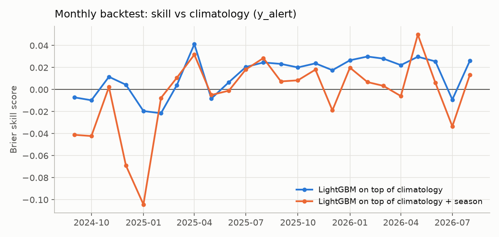

# Evaluation report

_Generated by `uaalerts report`. Do not edit by hand._

Data observed until **2026-10-10T09:50:59+00:00** · sources stitched at 2026-09-06T12:00:00+00:00 (hourly agreement in overlap 99.7%).

**Setup.** Forecast origins every 6 h (00/06/12/18 Kyiv); for every region and every lead 1-168 h the probability of an alert covering the oblast centre in that hour. Weekly walk-forward over the last 4 weeks: before each week the models are refit on rows whose labels were already known (origin + lead ≤ week start). The model choice (recency-weighted LightGBM) was fixed on the 4 weeks *before* the test period.

**Leakage controls.** Features at origin t use panel hours < t only; `tests/test_leakage.py` asserts that features from the full history equal features built from `as_of(events, t)`, and the runner asserts purging for every fold.

The 2026-09-06 reform (yellow = drones, red = missiles/ballistics/massed attacks) roughly quadrupled alert time in Kyiv; the whole test period lies after it.

## Alert of any level (`y_alert`)

Evaluation origins: 2026-09-12 09:00 → 2026-10-10 03:00 UTC · 364,056 scored (origin, region, lead) rows · excluded regions: crimea, donetska, luhanska, zaporizka

### Overall

| base_rate | model | brier | bss | log_loss | roc_auc | pr_auc |
|---|---|---|---|---|---|---|
| 0.420 | climatology | 0.163 | 0.000 | 0.543 | 0.844 | 0.780 |
| 0.420 | persistence | 0.163 | 0.003 | 0.540 | 0.846 | 0.788 |
| 0.420 | gbm_v1 | 0.163 | 0.000 | 0.489 | 0.838 | 0.777 |
| 0.420 | gbm_trend | 0.161 | 0.012 | 0.485 | 0.840 | 0.781 |
| 0.420 | gbm_resid | 0.161 | 0.013 | 0.486 | 0.841 | 0.780 |
| 0.420 | gbm_trend_season | 0.163 | 0.004 | 0.490 | 0.840 | 0.780 |
| 0.420 | gbm_resid_season | 0.163 | -0.001 | 0.493 | 0.838 | 0.777 |

### By lead time

| lead_bucket | base_rate | model | brier | bss | log_loss | roc_auc | pr_auc |
|---|---|---|---|---|---|---|---|
| 1-6h | 0.416 | climatology | 0.163 | 0.000 | 0.557 | 0.841 | 0.778 |
| 1-6h | 0.416 | persistence | 0.150 | 0.081 | 0.495 | 0.873 | 0.831 |
| 1-6h | 0.416 | gbm_v1 | 0.141 | 0.134 | 0.431 | 0.876 | 0.840 |
| 1-6h | 0.416 | gbm_resid | 0.140 | 0.138 | 0.430 | 0.877 | 0.838 |
| 7-24h | 0.414 | climatology | 0.161 | 0.000 | 0.544 | 0.844 | 0.779 |
| 7-24h | 0.414 | persistence | 0.161 | 0.001 | 0.539 | 0.845 | 0.788 |
| 7-24h | 0.414 | gbm_v1 | 0.160 | 0.008 | 0.484 | 0.842 | 0.786 |
| 7-24h | 0.414 | gbm_resid | 0.158 | 0.020 | 0.480 | 0.845 | 0.787 |
| 1-3d | 0.417 | climatology | 0.161 | 0.000 | 0.534 | 0.847 | 0.781 |
| 1-3d | 0.417 | persistence | 0.161 | 0.000 | 0.534 | 0.847 | 0.789 |
| 1-3d | 0.417 | gbm_v1 | 0.161 | -0.002 | 0.485 | 0.841 | 0.779 |
| 1-3d | 0.417 | gbm_resid | 0.159 | 0.010 | 0.482 | 0.844 | 0.780 |
| 4-7d | 0.424 | climatology | 0.165 | 0.000 | 0.547 | 0.844 | 0.781 |
| 4-7d | 0.424 | persistence | 0.165 | 0.000 | 0.547 | 0.844 | 0.781 |
| 4-7d | 0.424 | gbm_v1 | 0.167 | -0.010 | 0.496 | 0.832 | 0.768 |
| 4-7d | 0.424 | gbm_resid | 0.164 | 0.003 | 0.493 | 0.836 | 0.774 |

### By test week (model refit before each week)

| fold | base_rate | model | brier | bss | log_loss | roc_auc | pr_auc |
|---|---|---|---|---|---|---|---|
| dev-w1 | 0.416 | climatology | 0.168 | 0.000 | 0.594 | 0.852 | 0.778 |
| dev-w1 | 0.416 | gbm_resid | 0.157 | 0.063 | 0.476 | 0.851 | 0.783 |
| dev-w2 | 0.438 | climatology | 0.163 | 0.000 | 0.539 | 0.855 | 0.803 |
| dev-w2 | 0.438 | gbm_resid | 0.159 | 0.026 | 0.480 | 0.851 | 0.808 |
| dev-w3 | 0.378 | climatology | 0.146 | 0.000 | 0.452 | 0.860 | 0.789 |
| dev-w3 | 0.378 | gbm_resid | 0.156 | -0.068 | 0.466 | 0.859 | 0.789 |
| dev-w4 | 0.476 | climatology | 0.186 | 0.000 | 0.627 | 0.811 | 0.778 |
| dev-w4 | 0.476 | gbm_resid | 0.181 | 0.027 | 0.553 | 0.822 | 0.798 |

### By region (main model: `gbm_resid`)

| region | base_rate | brier | bss | roc_auc |
|---|---|---|---|---|
| lvivska | 0.007 | 0.010 | -0.296 | 0.337 |
| ivano_frankivska | 0.029 | 0.031 | -0.070 | 0.322 |
| zakarpatska | 0.004 | 0.005 | -0.070 | 0.339 |
| sumska | 0.916 | 0.080 | -0.033 | 0.623 |
| chernivetska | 0.036 | 0.037 | -0.024 | 0.437 |
| ternopilska | 0.094 | 0.090 | -0.019 | 0.464 |
| khersonska | 0.230 | 0.195 | -0.017 | 0.543 |
| cherkaska | 0.605 | 0.277 | -0.012 | 0.469 |
| kirovohradska | 0.580 | 0.258 | -0.010 | 0.482 |
| khmelnytska | 0.191 | 0.163 | -0.009 | 0.471 |
| kharkivska | 0.891 | 0.100 | -0.006 | 0.551 |
| rivnenska | 0.243 | 0.195 | -0.003 | 0.496 |
| volynska | 0.117 | 0.106 | 0.005 | 0.503 |
| dnipropetrovska | 0.507 | 0.256 | 0.005 | 0.520 |
| mykolaivska | 0.743 | 0.210 | 0.010 | 0.523 |
| poltavska | 0.740 | 0.215 | 0.015 | 0.498 |
| zhytomyrska | 0.386 | 0.250 | 0.028 | 0.497 |
| kyiv_city | 0.625 | 0.264 | 0.034 | 0.540 |
| vinnytska | 0.264 | 0.199 | 0.038 | 0.543 |
| kyivska | 0.587 | 0.274 | 0.053 | 0.460 |
| odeska | 0.499 | 0.260 | 0.056 | 0.519 |
| chernihivska | 0.946 | 0.072 | 0.060 | 0.620 |

 

## Red-level alert (`y_red`)

Evaluation origins: 2026-09-12 09:00 → 2026-10-10 03:00 UTC · 397,152 scored (origin, region, lead) rows · excluded regions: crimea, luhanska

### Overall

| base_rate | model | brier | bss | log_loss | roc_auc | pr_auc |
|---|---|---|---|---|---|---|
| 0.172 | climatology | 0.074 | 0.000 | 0.321 | 0.910 | 0.732 |
| 0.172 | persistence | 0.074 | 0.003 | 0.315 | 0.910 | 0.740 |
| 0.172 | gbm_v1 | 0.093 | -0.258 | 0.378 | 0.889 | 0.702 |
| 0.172 | gbm_resid | 0.087 | -0.166 | 0.361 | 0.896 | 0.723 |

### By lead time

| lead_bucket | base_rate | model | brier | bss | log_loss | roc_auc | pr_auc |
|---|---|---|---|---|---|---|---|
| 1-6h | 0.177 | climatology | 0.075 | 0.000 | 0.341 | 0.904 | 0.737 |
| 1-6h | 0.177 | persistence | 0.068 | 0.094 | 0.285 | 0.926 | 0.819 |
| 1-6h | 0.177 | gbm_v1 | 0.091 | -0.204 | 0.362 | 0.894 | 0.729 |
| 1-6h | 0.177 | gbm_resid | 0.084 | -0.116 | 0.348 | 0.900 | 0.745 |
| 7-24h | 0.175 | climatology | 0.074 | 0.000 | 0.321 | 0.909 | 0.742 |
| 7-24h | 0.175 | persistence | 0.075 | -0.014 | 0.315 | 0.906 | 0.750 |
| 7-24h | 0.175 | gbm_v1 | 0.094 | -0.270 | 0.376 | 0.887 | 0.710 |
| 7-24h | 0.175 | gbm_resid | 0.087 | -0.176 | 0.358 | 0.895 | 0.729 |
| 1-3d | 0.174 | climatology | 0.075 | 0.000 | 0.330 | 0.908 | 0.732 |
| 1-3d | 0.174 | persistence | 0.074 | 0.004 | 0.325 | 0.908 | 0.734 |
| 1-3d | 0.174 | gbm_v1 | 0.094 | -0.263 | 0.380 | 0.887 | 0.698 |
| 1-3d | 0.174 | gbm_resid | 0.087 | -0.165 | 0.362 | 0.894 | 0.720 |
| 4-7d | 0.171 | climatology | 0.074 | 0.000 | 0.315 | 0.911 | 0.729 |
| 4-7d | 0.171 | persistence | 0.074 | 0.000 | 0.312 | 0.911 | 0.732 |
| 4-7d | 0.171 | gbm_v1 | 0.093 | -0.256 | 0.379 | 0.890 | 0.701 |
| 4-7d | 0.171 | gbm_resid | 0.087 | -0.168 | 0.362 | 0.897 | 0.722 |

### By test week (model refit before each week)

| fold | base_rate | model | brier | bss | log_loss | roc_auc | pr_auc |
|---|---|---|---|---|---|---|---|
| dev-w1 | 0.206 | climatology | 0.084 | 0.000 | 0.420 | 0.893 | 0.768 |
| dev-w1 | 0.206 | persistence | 0.084 | 0.000 | 0.410 | 0.894 | 0.774 |
| dev-w2 | 0.174 | climatology | 0.073 | 0.000 | 0.300 | 0.912 | 0.768 |
| dev-w2 | 0.174 | persistence | 0.073 | -0.004 | 0.296 | 0.911 | 0.771 |
| dev-w3 | 0.155 | climatology | 0.068 | 0.000 | 0.266 | 0.924 | 0.719 |
| dev-w3 | 0.155 | persistence | 0.067 | 0.010 | 0.263 | 0.925 | 0.728 |
| dev-w4 | 0.139 | climatology | 0.071 | 0.000 | 0.279 | 0.921 | 0.656 |
| dev-w4 | 0.139 | persistence | 0.070 | 0.013 | 0.270 | 0.921 | 0.669 |

### By region (main model: `persistence`)

| region | base_rate | brier | bss | roc_auc |
|---|---|---|---|---|
| kharkivska | 0.603 | 0.246 | -0.018 | 0.585 |
| dnipropetrovska | 0.428 | 0.261 | -0.003 | 0.514 |
| kyivska | 0.067 | 0.066 | -0.002 | 0.554 |
| mykolaivska | 0.078 | 0.081 | -0.001 | 0.498 |
| poltavska | 0.086 | 0.083 | 0.001 | 0.541 |
| khersonska | 0.072 | 0.076 | 0.002 | 0.506 |
| sumska | 0.533 | 0.265 | 0.002 | 0.607 |
| vinnytska | 0.036 | 0.035 | 0.003 | 0.652 |
| kirovohradska | 0.069 | 0.069 | 0.004 | 0.491 |
| kyiv_city | 0.053 | 0.053 | 0.005 | 0.640 |
| ivano_frankivska | 0.007 | 0.008 | 0.006 | 0.534 |
| cherkaska | 0.120 | 0.110 | 0.006 | 0.519 |
| odeska | 0.057 | 0.063 | 0.007 | 0.520 |
| zaporizka | 0.854 | 0.131 | 0.010 | 0.492 |
| lvivska | 0.004 | 0.004 | 0.011 | 0.431 |
| ternopilska | 0.004 | 0.004 | 0.011 | 0.431 |
| volynska | 0.004 | 0.004 | 0.011 | 0.431 |
| zakarpatska | 0.004 | 0.004 | 0.011 | 0.431 |
| chernivetska | 0.004 | 0.005 | 0.016 | 0.410 |
| zhytomyrska | 0.058 | 0.057 | 0.026 | 0.552 |
| donetska | 0.935 | 0.071 | 0.028 | 0.480 |
| rivnenska | 0.004 | 0.005 | 0.031 | 0.390 |
| khmelnytska | 0.004 | 0.006 | 0.037 | 0.349 |
| chernihivska | 0.053 | 0.067 | 0.047 | 0.678 |

 

## Two-year monthly backtest (`y_alert`)

Monthly refits from 2024-09 to 2026-08 (24 folds, two winters, all before the 2026-09-06 reform). Used to decide on seasonal features, which a 4-week dev period cannot judge.

### Overall

| model | base_rate | brier | bss | roc_auc | pr_auc |
|---|---|---|---|---|---|
| climatology | 0.262 | 0.124 | 0.000 | 0.858 | 0.712 |
| persistence | 0.262 | 0.123 | 0.004 | 0.859 | 0.721 |
| gbm_resid | 0.262 | 0.122 | 0.013 | 0.864 | 0.728 |
| gbm_resid_season | 0.262 | 0.124 | -0.005 | 0.858 | 0.720 |
| gbm_resid_dark | 0.262 | 0.122 | 0.012 | 0.863 | 0.727 |

### Brier skill score by lead time

| model | 1-6h | 7-24h | 1-3d | 4-7d |
|---|---|---|---|---|
| climatology | 0.000 | 0.000 | 0.000 | 0.000 |
| gbm_resid | 0.133 | 0.011 | 0.009 | 0.008 |
| gbm_resid_dark | 0.128 | 0.010 | 0.008 | 0.007 |
| gbm_resid_season | 0.087 | -0.009 | -0.009 | -0.008 |
| persistence | 0.111 | 0.001 | 0.000 | 0.000 |

Months with skill > 0: `gbm_resid` 18/24, `gbm_resid_dark` 17/24, `gbm_resid_season` 14/24, `persistence` 24/24

**Decision.** Seasonal features (month, day of year, last-year analog, solar elevation) make the model worse: better than the model without them in only 5 of 24 months, and worst in winter. Darkness alone is neutral (8/24). The data show no stable annual cycle of alert hours, so the final model uses none of them.

## Limitations

- Real skill is concentrated in the first 6 hours (+13% Brier vs climatology); beyond a day the model is only marginally better than the 28-day hour-of-day climatology.
- Trend features over-react to bursts: after the spikes of 24.09 and 30.09 the model expected escalation, but 01-03.10 were calm (dev week 3).
- The red-level target has only weeks of history.
- The target counts hours under alert, not the scale or damage of an attack.
- Fresh data come from a daily-synced mirror, so the operational forecast can lag by up to a day.
