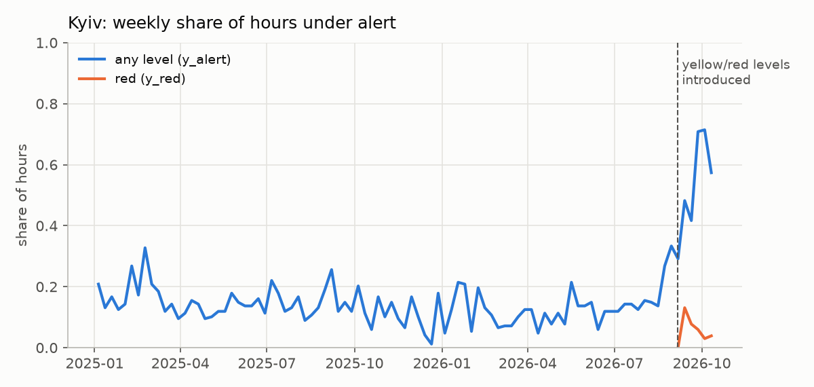
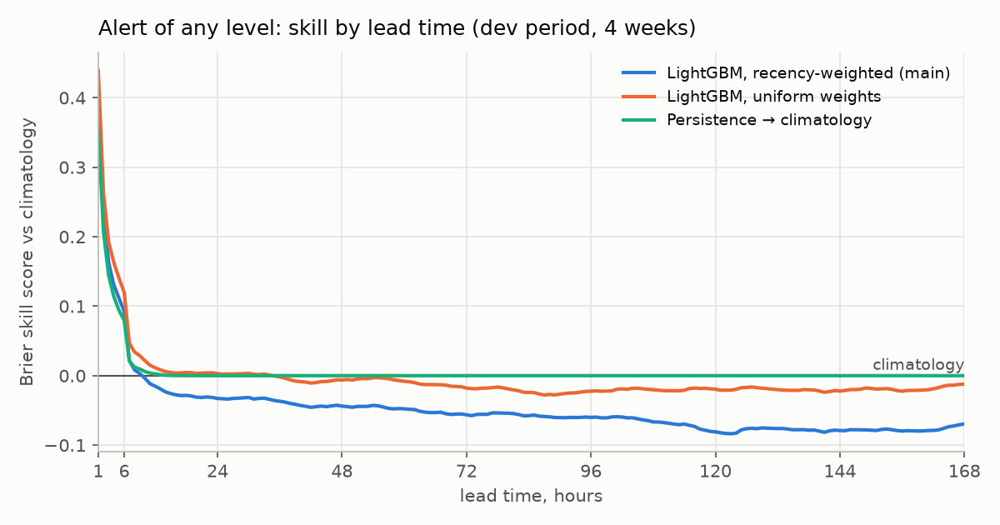
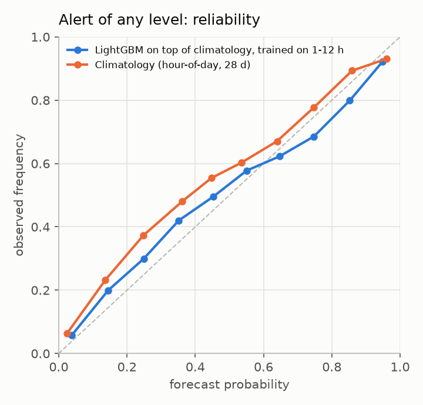
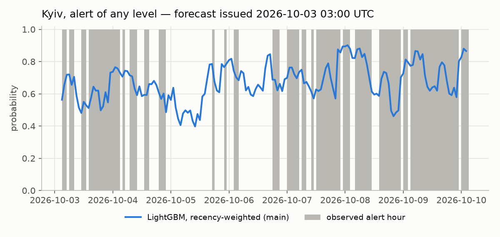
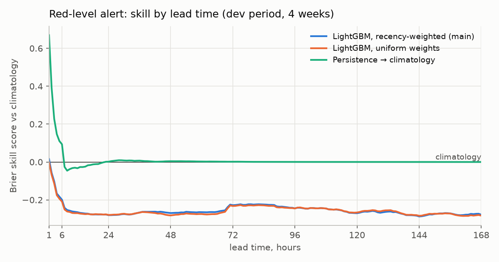
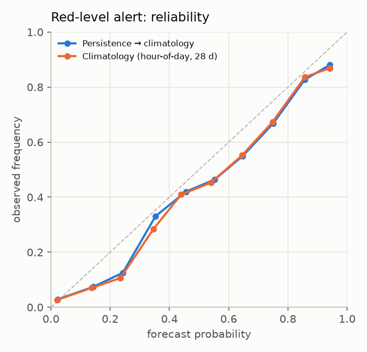
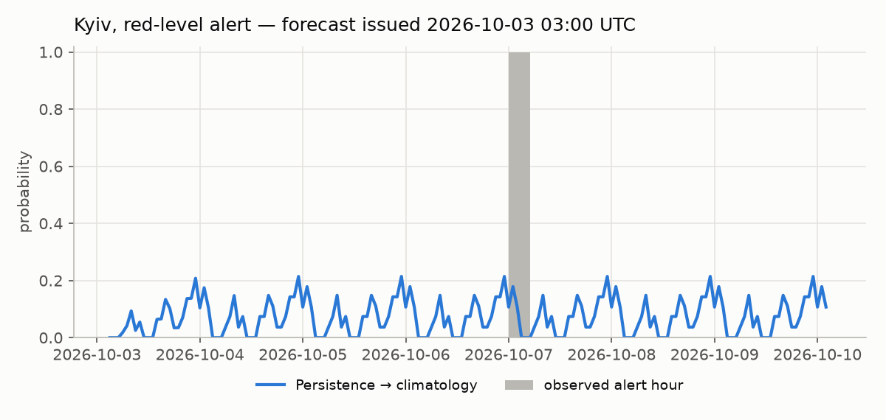

# Evaluation report

_Generated by `uaalerts report`. Do not edit by hand._

Data observed until **2026-10-10T09:50:59+00:00** · sources stitched at 2026-09-06T12:00:00+00:00 (hourly agreement in overlap 99.7%).

**Setup.** Forecast origins every 6 h (00/06/12/18 Kyiv); for every region and every lead 1-168 h the probability of an alert covering the oblast centre in that hour. Weekly walk-forward over the last 4 weeks: before each week the models are refit on rows whose labels were already known (origin + lead ≤ week start). The model choice (recency-weighted LightGBM) was fixed on the 4 weeks *before* the test period.

**Leakage controls.** Features at origin t use panel hours < t only; `tests/test_leakage.py` asserts that features from the full history equal features built from `as_of(events, t)`, and the runner asserts purging for every fold.

The 2026-09-06 reform (yellow = drones, red = missiles/ballistics/massed attacks) roughly quadrupled alert time in Kyiv; the whole test period lies after it.

## Alert of any level (`y_alert`)

Test origins: 2026-09-12 09:00 → 2026-10-10 03:00 UTC · 364,056 scored (origin, region, lead) rows · excluded regions: crimea, donetska, luhanska, zaporizka

### Overall

| base_rate | model | brier | bss | log_loss | roc_auc | pr_auc |
|---|---|---|---|---|---|---|
| 0.420 | climatology | 0.163 | 0.000 | 0.543 | 0.844 | 0.780 |
| 0.420 | persistence | 0.163 | 0.003 | 0.540 | 0.846 | 0.788 |
| 0.420 | gbm | 0.164 | -0.007 | 0.493 | 0.836 | 0.772 |
| 0.420 | gbm_hl90 | 0.171 | -0.050 | 0.516 | 0.828 | 0.764 |

### By lead time

| lead_bucket | base_rate | model | brier | bss | log_loss | roc_auc | pr_auc |
|---|---|---|---|---|---|---|---|
| 1-6h | 0.416 | climatology | 0.163 | 0.000 | 0.557 | 0.841 | 0.778 |
| 1-6h | 0.416 | persistence | 0.150 | 0.081 | 0.495 | 0.873 | 0.831 |
| 1-6h | 0.416 | gbm_hl90 | 0.147 | 0.095 | 0.452 | 0.867 | 0.822 |
| 7-24h | 0.414 | climatology | 0.161 | 0.000 | 0.544 | 0.844 | 0.779 |
| 7-24h | 0.414 | persistence | 0.161 | 0.001 | 0.539 | 0.845 | 0.788 |
| 7-24h | 0.414 | gbm_hl90 | 0.165 | -0.026 | 0.504 | 0.837 | 0.777 |
| 1-3d | 0.417 | climatology | 0.161 | 0.000 | 0.534 | 0.847 | 0.781 |
| 1-3d | 0.417 | persistence | 0.161 | 0.000 | 0.534 | 0.847 | 0.789 |
| 1-3d | 0.417 | gbm_hl90 | 0.168 | -0.045 | 0.509 | 0.833 | 0.769 |
| 4-7d | 0.424 | climatology | 0.165 | 0.000 | 0.547 | 0.844 | 0.781 |
| 4-7d | 0.424 | persistence | 0.165 | 0.000 | 0.547 | 0.844 | 0.781 |
| 4-7d | 0.424 | gbm_hl90 | 0.177 | -0.070 | 0.528 | 0.820 | 0.753 |

### By test week (model refit before each week)

| fold | base_rate | model | brier | bss | log_loss | roc_auc | pr_auc |
|---|---|---|---|---|---|---|---|
| dev-w1 | 0.416 | climatology | 0.168 | 0.000 | 0.594 | 0.852 | 0.778 |
| dev-w1 | 0.416 | gbm_hl90 | 0.165 | 0.021 | 0.499 | 0.842 | 0.774 |
| dev-w2 | 0.438 | climatology | 0.163 | 0.000 | 0.539 | 0.855 | 0.803 |
| dev-w2 | 0.438 | gbm_hl90 | 0.170 | -0.039 | 0.508 | 0.837 | 0.791 |
| dev-w3 | 0.378 | climatology | 0.146 | 0.000 | 0.452 | 0.860 | 0.789 |
| dev-w3 | 0.378 | gbm_hl90 | 0.168 | -0.147 | 0.498 | 0.849 | 0.775 |
| dev-w4 | 0.476 | climatology | 0.186 | 0.000 | 0.627 | 0.811 | 0.778 |
| dev-w4 | 0.476 | gbm_hl90 | 0.195 | -0.048 | 0.602 | 0.806 | 0.780 |

### By region (main model)

| region | base_rate | brier | bss | roc_auc |
|---|---|---|---|---|
| lvivska | 0.007 | 0.010 | -0.364 | 0.341 |
| khersonska | 0.230 | 0.213 | -0.109 | 0.497 |
| cherkaska | 0.605 | 0.300 | -0.098 | 0.462 |
| sumska | 0.916 | 0.085 | -0.089 | 0.629 |
| dnipropetrovska | 0.507 | 0.277 | -0.077 | 0.493 |
| ivano_frankivska | 0.029 | 0.031 | -0.076 | 0.361 |
| kirovohradska | 0.580 | 0.274 | -0.073 | 0.495 |
| poltavska | 0.740 | 0.232 | -0.066 | 0.471 |
| khmelnytska | 0.191 | 0.172 | -0.065 | 0.480 |
| zhytomyrska | 0.386 | 0.273 | -0.064 | 0.452 |
| rivnenska | 0.243 | 0.206 | -0.059 | 0.463 |
| mykolaivska | 0.743 | 0.223 | -0.051 | 0.507 |
| ternopilska | 0.094 | 0.093 | -0.051 | 0.428 |
| zakarpatska | 0.004 | 0.004 | -0.047 | 0.267 |
| kyivska | 0.587 | 0.300 | -0.037 | 0.466 |
| kharkivska | 0.891 | 0.102 | -0.031 | 0.587 |
| kyiv_city | 0.625 | 0.279 | -0.024 | 0.533 |
| vinnytska | 0.264 | 0.209 | -0.010 | 0.536 |
| volynska | 0.117 | 0.108 | -0.009 | 0.514 |
| chernivetska | 0.036 | 0.036 | -0.004 | 0.448 |
| odeska | 0.499 | 0.273 | 0.011 | 0.497 |
| chernihivska | 0.946 | 0.070 | 0.078 | 0.628 |

 

## Red-level alert (`y_red`)

Test origins: 2026-09-12 09:00 → 2026-10-10 03:00 UTC · 397,152 scored (origin, region, lead) rows · excluded regions: crimea, luhanska

### Overall

| base_rate | model | brier | bss | log_loss | roc_auc | pr_auc |
|---|---|---|---|---|---|---|
| 0.172 | climatology | 0.074 | 0.000 | 0.321 | 0.910 | 0.732 |
| 0.172 | persistence | 0.074 | 0.003 | 0.315 | 0.910 | 0.740 |
| 0.172 | gbm | 0.093 | -0.258 | 0.378 | 0.889 | 0.702 |
| 0.172 | gbm_hl90 | 0.093 | -0.255 | 0.376 | 0.890 | 0.707 |

### By lead time

| lead_bucket | base_rate | model | brier | bss | log_loss | roc_auc | pr_auc |
|---|---|---|---|---|---|---|---|
| 1-6h | 0.177 | climatology | 0.075 | 0.000 | 0.341 | 0.904 | 0.737 |
| 1-6h | 0.177 | persistence | 0.068 | 0.094 | 0.285 | 0.926 | 0.819 |
| 1-6h | 0.177 | gbm_hl90 | 0.090 | -0.194 | 0.359 | 0.896 | 0.735 |
| 7-24h | 0.175 | climatology | 0.074 | 0.000 | 0.321 | 0.909 | 0.742 |
| 7-24h | 0.175 | persistence | 0.075 | -0.014 | 0.315 | 0.906 | 0.750 |
| 7-24h | 0.175 | gbm_hl90 | 0.093 | -0.268 | 0.374 | 0.889 | 0.715 |
| 1-3d | 0.174 | climatology | 0.075 | 0.000 | 0.330 | 0.908 | 0.732 |
| 1-3d | 0.174 | persistence | 0.074 | 0.004 | 0.325 | 0.908 | 0.734 |
| 1-3d | 0.174 | gbm_hl90 | 0.094 | -0.257 | 0.377 | 0.889 | 0.705 |
| 4-7d | 0.171 | climatology | 0.074 | 0.000 | 0.315 | 0.911 | 0.729 |
| 4-7d | 0.171 | persistence | 0.074 | 0.000 | 0.312 | 0.911 | 0.732 |
| 4-7d | 0.171 | gbm_hl90 | 0.093 | -0.255 | 0.377 | 0.891 | 0.706 |

### By test week (model refit before each week)

| fold | base_rate | model | brier | bss | log_loss | roc_auc | pr_auc |
|---|---|---|---|---|---|---|---|
| dev-w1 | 0.206 | climatology | 0.084 | 0.000 | 0.420 | 0.893 | 0.768 |
| dev-w1 | 0.206 | gbm_hl90 | 0.123 | -0.476 | 0.537 | 0.860 | 0.702 |
| dev-w2 | 0.174 | climatology | 0.073 | 0.000 | 0.300 | 0.912 | 0.768 |
| dev-w2 | 0.174 | gbm_hl90 | 0.081 | -0.107 | 0.326 | 0.904 | 0.760 |
| dev-w3 | 0.155 | climatology | 0.068 | 0.000 | 0.266 | 0.924 | 0.719 |
| dev-w3 | 0.155 | gbm_hl90 | 0.083 | -0.221 | 0.325 | 0.911 | 0.695 |
| dev-w4 | 0.139 | climatology | 0.071 | 0.000 | 0.279 | 0.921 | 0.656 |
| dev-w4 | 0.139 | gbm_hl90 | 0.079 | -0.110 | 0.259 | 0.920 | 0.658 |

### By region (main model)

| region | base_rate | brier | bss | roc_auc |
|---|---|---|---|---|
| rivnenska | 0.004 | 0.010 | -0.868 | 0.242 |
| khmelnytska | 0.004 | 0.010 | -0.652 | 0.288 |
| donetska | 0.935 | 0.119 | -0.629 | 0.402 |
| volynska | 0.004 | 0.007 | -0.558 | 0.308 |
| chernivetska | 0.004 | 0.007 | -0.522 | 0.124 |
| ternopilska | 0.004 | 0.006 | -0.412 | 0.189 |
| khersonska | 0.072 | 0.105 | -0.389 | 0.471 |
| kirovohradska | 0.069 | 0.091 | -0.304 | 0.503 |
| mykolaivska | 0.078 | 0.105 | -0.297 | 0.426 |
| dnipropetrovska | 0.428 | 0.336 | -0.293 | 0.486 |
| chernihivska | 0.053 | 0.089 | -0.264 | 0.524 |
| sumska | 0.533 | 0.334 | -0.258 | 0.544 |
| kyivska | 0.067 | 0.082 | -0.237 | 0.459 |
| kharkivska | 0.603 | 0.297 | -0.229 | 0.562 |
| vinnytska | 0.036 | 0.043 | -0.213 | 0.485 |
| poltavska | 0.086 | 0.100 | -0.204 | 0.501 |
| lvivska | 0.004 | 0.005 | -0.196 | 0.118 |
| kyiv_city | 0.053 | 0.063 | -0.182 | 0.409 |
| cherkaska | 0.120 | 0.131 | -0.175 | 0.488 |
| zaporizka | 0.854 | 0.154 | -0.164 | 0.637 |
| zhytomyrska | 0.058 | 0.067 | -0.141 | 0.470 |
| odeska | 0.057 | 0.063 | -0.000 | 0.487 |
| ivano_frankivska | 0.007 | 0.008 | 0.039 | 0.340 |
| zakarpatska | 0.004 | 0.004 | 0.095 | 0.055 |

 
